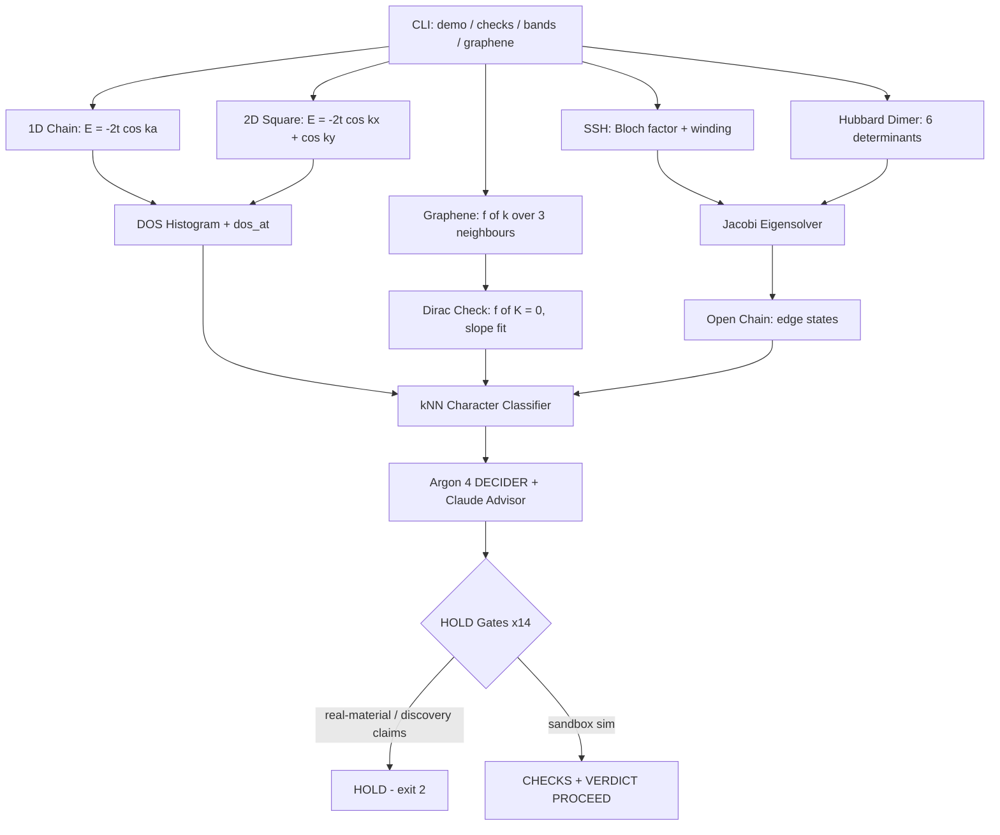
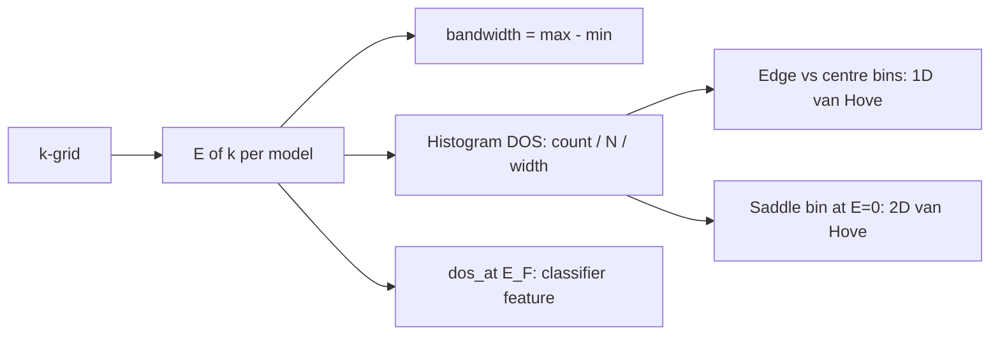
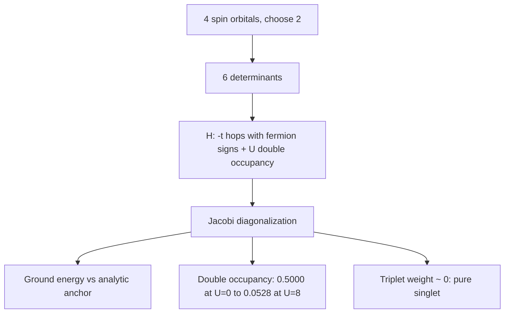
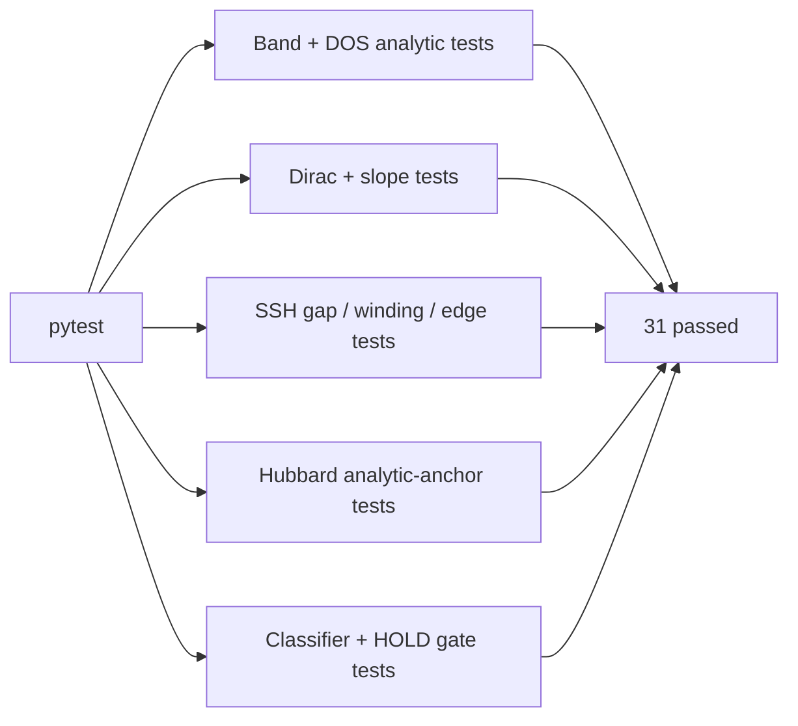
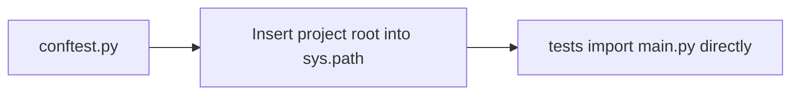
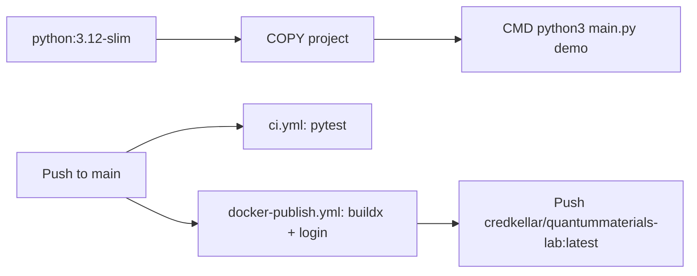

# QuantumMaterials-Lab 🧱⚛️

**Quantum Materials Tight-Binding Lab** — by Darion Kellar

QuantumMaterials-Lab is an **educational quantum-materials lab** in ONE pure-Python file. It computes **tight-binding band structures exactly on toy lattices** — a 1D chain, a 2D square lattice, a graphene-style honeycomb, a dimerized SSH chain, and a two-site Hubbard dimer — and demonstrates, with numbers it calculates rather than quotes, the five ideas that organise quantum materials: **van Hove singularities, Dirac cones, topological winding, bulk-boundary correspondence, and correlation-driven occupancy**.

The honest scope is the whole point, and it is stated everywhere:

- ✅ **What it proves:** theorems about the toy models — the 1D density of states really does pile up at the band edges (edge bin **1.0222** vs centre **0.1588**), graphene's bands really do touch at K with |f(K)| = **4.44e-16**, the SSH chain really does hide two zero-energy edge states (**4.99e-08**) exactly when its winding number is 1, and the Hubbard dimer's double occupancy really does drain from **0.500000** to **0.052786** as U grows.
- 🚫 **What it can never prove:** anything about a real material. Every hopping is a labelled teaching parameter (t = 1), every lattice constant a labelled toy value. No band structure, gap, or property of any real substance is predicted, fitted, or measured here.

Every real-material / discovery / superconductor / device / synthesis / battery / semiconductor / quantum-hardware / weapons / medical / investment / patent claim sits behind a permanent HOLD gate (14 total). 🔒

[](https://github.com/kimanicollier44-cmyk/QuantumMaterials-Lab/actions/workflows/ci.yml)
[](https://github.com/kimanicollier44-cmyk/QuantumMaterials-Lab/actions/workflows/docker-publish.yml)

> ℹ️ These are the **live** workflow badges for this repo. They activate as soon as the `ci.yml` and `docker-publish.yml` files from the paste pack are pasted into `.github/workflows/` — until then they have nothing to report yet.

## 🧰 Tech Stack Badges & Full Architecture Tech Stack

### 💻 Core Programming Languages & Core Systems


- 🐍 Python 3.12, pure standard library (`math`, `cmath`, `hashlib`, `json`, `sys`, `itertools`) — zero dependencies, zero network, deterministic (double-run byte-identical)
- 🎸 Tight-binding core: dispersions evaluated on explicit k-grids (4,001 points for the chain, 301×301 for the square lattice, a full reciprocal-cell grid for graphene) — every extremum the checks assert is visible in the samples, nothing is fitted
- 📐 Eigensolver from scratch: a cyclic Jacobi solver for real symmetric matrices (eigenvalues + eigenvectors, reconstruction asserted to < 1e-9) diagonalizes the 40×40 SSH open chain and the 6×6 Hubbard dimer
- 🌀 Topology toolkit: Bloch factor d(k) = t1 + t2·e^(ika), winding by summed phase increments, Zak phase = π × winding, and a finite open chain that makes the topology visible as edge states
- 🧠 TinyML kNN material-character classifier (from scratch, stdlib): metal / insulator / dirac-semimetal / topological from (gap, DOS at E_F, winding), with every training row computed by the lab's own models
- 🪑 Council seats: Gemini Argon 4 DECIDER (names-only, tighten-only) + Muse advisor (never overrides HOLD) + Google Flow plan-only (rendered = False, live = 0)

### ⛓️ Web3 & Infrastructure

- 🚫 **Not applicable — honestly.** No blockchain, no Web3, no tokens: the "infrastructure" here is one offline Python file, a Docker image, and a GitHub Actions pipeline. No fake badges here.

### ⚙️ Platform Support & Hardware Architecture


- 🖥️ Pure Python — runs anywhere Python 3.12+ runs (Linux, macOS, Windows), plus the `python:3.12-slim` Docker image
- 🔒 No laboratory hardware is touched, ever: synthesis, growth, and measurement of real materials are permanent HOLD gates (see the gate table below)

### ⚡ Low-Level Infrastructure & Performance

- 🚫 **No low-level code — honestly.** No C, no C++, no GPU, no compiled extensions: one interpreted Python file on purpose, so every hopping, phase increment, and Jacobi rotation can be read, checked, and diffed. Performance here means honest grids — the DOS histograms use enough k-points that the van Hove peaks are measured, not drawn.

### 🛠️ DevOps & Build Tools


- 🐳 Docker (`python:3.12-slim`), GitHub Actions CI + Docker Publish (delivered in the paste pack)
- 🎯 Target image: `credkellar/quantummaterials-lab:latest`
- 🧪 Tests: `pytest` (31 tests) + the built-in CHECKS suite (59 checks) in `main.py`

### ☁️ Cloud Providers

- 🚫 **None — honestly.** No cloud provider is used or needed: the lab runs fully offline on your own machine or in a local Docker container. Docker Hub appears only as the registry the publish workflow pushes the image to.

## What this does?

1. ⛓️ **1D chain band** — E(k) = −2t·cos(ka) on a 4,001-point k-grid: bandwidth exactly **4t**, E(Γ) = −2t, E(π) = +2t, all asserted. The simplest band there is, computed exactly.
2. 📊 **Density of states + the 1D van Hove singularity** — a histogram DOS (no smoothing) shows states piling up where the band flattens: edge bin **1.0222** vs centre bin **0.1588**, a 6.4× pile-up that the checks assert instead of admire.
3. ♟️ **2D square lattice** — E(k) = −2t(cos kx + cos ky), bandwidth **8t**. Its DOS peaks exactly at E = 0 (saddle bin **0.3118** vs edge **0.0804**): at half filling the Fermi level sits on the van Hove saddle, which is why this lattice is the theorist's favourite instability machine.
4. 🍯 **Graphene toy — Dirac cones** — the honeycomb structure factor f(k) = Σ exp(i k·δⱼ) vanishes at K and K′ (|f| = **4.44e-16** < 1e-9), the bands touch, and the fitted cone slope **1.4814** lands within 1.3% of the textbook (3/2)·t·a — the Fermi velocity is *labelled* ℏv_F = (3/2)ta, and the DOS at E_F nearly vanishes (**0.0118** vs 0.2029 at 1.5t): a semimetal, computed.
5. 🔢 **Jacobi eigensolver, from scratch** — cyclic Jacobi rotations with eigenvectors, proven in the checks by rebuilding A = VΛVᵀ to < 1e-9 on a real Hamiltonian. No numpy anywhere: the two finite systems below are diagonalized by code you can read.
6. 🔗 **SSH chain — bulk topology** — dimerized hoppings t1/t2 give bands E = ±|t1 + t2·e^(ika)| and a bulk gap of exactly **2|t1 − t2|** (1.6 for the demo pair, both phases). The winding of d(k) around the origin is computed by summed phase increments: **0** when t1 > t2, **1** when t2 > t1; Zak phase 0 vs π.
7. 🧲 **SSH chain — edge states** — a 20-cell OPEN chain (40×40, Jacobi-diagonalized) turns the invariant into physics: in the topological phase two states sit at |E| = **4.99e-08**, midgap; in the trivial phase the smallest |E| is **0.811**, above the half-gap. Bulk-boundary correspondence, demonstrated — and the spectrum's chiral ±E symmetry is asserted eigenvalue by eigenvalue.
8. ⚡ **Hubbard dimer — correlations** — two sites, two electrons, the 6-determinant basis with exact fermionic signs: ground energy and double occupancy match the analytic anchors (U − √(U² + 16t²))/2 and (1 − U/√(U² + 16t²))/2 to < 1e-9 at every U. As U runs 0 → 8, double occupancy drains **0.500000 → 0.052786** while the ground state stays a pure singlet (triplet weight < 1e-9).
9. 🏷️ **Material-character classifier** — a from-scratch kNN over rows the lab computes itself (chain at three hoppings, square, graphene, an SSH sweep): the chain and square classify **metal**, graphene **dirac-semimetal**, trivial SSH **insulator**, topological SSH **topological** — and the checks force the classifier to agree with the policy that labelled its rows.
10. 🪑 **Seats + checks** — Argon 4 DECIDER (sha256 trace), Muse advisor, Google Flow plan-only, 14 HOLD gates, and a built-in CHECKS suite (59 checks) that re-derives every headline number above before the demo may print PROCEED.

## 🗺️ How it works — diagram per script

### `main.py` — the whole lab



### `main.py` § bands + DOS — dispersions and van Hove structure



### `main.py` § graphene — the Dirac cone

```mermaid
flowchart TD
    A[3 neighbour vectors delta_j] --> B[f of k = sum exp i k delta]
    B --> C[|f of K| and |f of K'| < 1e-9: bands touch]
    B --> D[|f of Gamma| = 3: bands at -+3t]
    B --> E[Slope fit near K: 1.4814]
    E --> F[Labelled hbar v_F = 3/2 t a]
    B --> G[BZ grid energies: DOS at E_F ~ 0]
```

### `main.py` § SSH — winding to edge states

```mermaid
flowchart TD
    A[t1 intracell, t2 intercell] --> B[d of k = t1 + t2 exp ika]
    B --> C[Bulk gap = 2 |t1 - t2|]
    B --> D[Winding by phase increments: 0 or 1]
    D --> E[Zak phase = pi x winding]
    A --> F[Open chain 40x40 Hamiltonian]
    F --> G[Jacobi diagonalization]
    G --> H{Winding = 1?}
    H -->|yes| I[2 midgap states at E ~ 5e-8]
    H -->|no| J[min |E| = 0.811, no edge states]
```

### `main.py` § Hubbard dimer — exact correlations



### `tests/test_main.py` — verification



### `conftest.py` — test path setup



### `Dockerfile` + CI flow — container & publish



## Why is this cool?

1. 📊 The van Hove singularity is **measured, not drawn**: the 1D DOS histogram really does spike 6.4× at the band edges, because the code counts states on a 4,001-point grid instead of sketching a curve from a textbook.
2. 🍯 Graphene's Dirac point is a **zero the code has to earn**: f(K) is a sum of three complex exponentials that cancels to 4.44e-16 — and the cone slope then lands within 1.3% of (3/2)ta with no fitting freedom anywhere.
3. 🌀 Topology you can **count on your fingers**: the winding number is literally the number of times d(k) circles the origin, summed phase step by phase step — and flipping t1 ↔ t2 flips it from 0 to 1.
4. 🧲 The edge states are **found, not inserted**: diagonalize a 40-site open chain and two eigenvalues sit at 5e-8 in a gap of 1.6 — bulk-boundary correspondence falling out of a matrix you built by hand.
5. ⚡ The Hubbard dimer is **exact against its own analytic answer**: two independent derivations (determinant diagonalization vs the closed-form anchors) agree to < 1e-9 at every U on the curve.
6. 🎸 Double occupancy draining 0.5000 → 0.0528 as U grows is the **Mott idea in six determinants**: the smallest possible stage on which correlation physics still performs.
7. ♟️ The square lattice's DOS peak sits **exactly at half filling** — the lab shows you the van Hove saddle that makes this toy lattice the birthplace of a thousand instability papers.
8. 🔢 The Jacobi eigensolver is **proven inside the lab**: it rebuilds its input matrix from its own eigenvectors to < 1e-9 before any spectrum is trusted.
9. 🏷️ The classifier's training data is **computed, not typed**: every row is a band structure this same file evaluated, so the kNN can only ever interpolate physics the lab actually did.
10. 🎯 Deterministic end to end: run it twice, get byte-identical output — a materials lab you can diff.

## What problems this solves?

1. ❌ **Problem:** "Van Hove singularity" is usually a picture in a textbook with no numbers attached. ✅ **Solution:** The DOS is a counted histogram; the edge-vs-centre ratio (1.0222 vs 0.1588) and the square lattice's saddle peak are asserted in CHECKS.
2. ❌ **Problem:** Dirac cones get explained with the word "relativistic" and no arithmetic. ✅ **Solution:** f(K) = 0 is verified to 4.44e-16, the dispersion is fitted near K, and the slope is compared against the labelled (3/2)ta with the 1.3% miss printed, not hidden.
3. ❌ **Problem:** Topological invariants are often presented as magic integers from nowhere. ✅ **Solution:** The winding is an explicit sum of phase increments over 4,000 k-points; anyone can watch it accumulate to 0 or 2π.
4. ❌ **Problem:** "Bulk-boundary correspondence" sounds like a slogan until you see an edge state. ✅ **Solution:** The open chain is diagonalized in both phases: 2 midgap states when winding = 1, none (min |E| = 0.811) when winding = 0.
5. ❌ **Problem:** Toy-model numbers quietly mutate into real-material claims as they get quoted. ✅ **Solution:** Every parameter is labelled a toy value in the docstring, the README, and the demo — and `toy_model_as_measurement_claim` plus `real_material_prediction_claim` are permanent HOLD gates.
6. ❌ **Problem:** Correlation (Hubbard U) is usually hidden inside a DFT package. ✅ **Solution:** The dimer is six determinants with visible fermionic signs; U's effect on double occupancy is a five-point curve checked against closed forms.
7. ❌ **Problem:** Eigensolvers are treated as infallible black boxes. ✅ **Solution:** The from-scratch Jacobi solver must reconstruct its input (VΛVᵀ = A to < 1e-9) and preserve the trace before its spectra are used.
8. ❌ **Problem:** "Metal vs insulator vs semimetal" labels get attached by eyeballing plots. ✅ **Solution:** A stated policy (gap, DOS at E_F, winding) labels computed rows, and a kNN must reproduce the policy on every scenario — disagreement fails the checks.
9. ❌ **Problem:** Finite-size effects are swept under the rug in chain models. ✅ **Solution:** The trivial chain's min |E| (0.811) is reported next to the bulk half-gap (0.8), and the edge-state splitting (4.99e-08) is printed rather than rounded to "zero".
10. ❌ **Problem:** Simulation tools quietly imply a discovery is next. ✅ **Solution:** 14 named HOLD gates return exit code 2 for every discovery, device, synthesis, or production claim, forever.

## How to install this?

1. 📋 Clone or download this project folder.
2. 🐍 Make sure Python 3.12+ is installed: `python3 --version`
3. ▶️ Run the full demo + checks (no arguments needed):

```bash
python3 main.py
```

4. 🧪 Run the test suite:

```bash
pip install pytest
python3 -m pytest -q
```

5. 🎛️ Try the other commands:

```bash
python3 main.py checks    # 59 built-in checks
python3 main.py bands     # 1D chain + 2D square: bandwidths, DOS, van Hove bins
python3 main.py graphene  # Dirac points, fitted slope, labelled Fermi velocity
python3 main.py ssh       # bulk gap, winding, Zak phase, edge-state report
python3 main.py hubbard   # Hubbard dimer U-curve vs analytic anchors
python3 main.py classify  # kNN material-character classifier report
python3 main.py brains    # Argon 4 + Muse + Flow seats
python3 main.py holds     # list all 14 HOLD gates
python3 main.py hold-demo # exits 2 - gated actions stay HOLD
```

6. 🐳 Or run it in Docker:

```bash
docker build -t credkellar/quantummaterials-lab:latest .
docker run --rm credkellar/quantummaterials-lab:latest
```

## Requirements

- 🐍 Python 3.12 or newer
- 📦 Dependencies: **none** (standard library only)
- 🌐 Network: **none** — fully offline
- 🧪 For tests only: `pytest`
- 🐳 Optional: Docker

## FULL project structure tree

```text
quantummaterials-lab/
├── main.py                  # the whole lab: 1D/2D bands, DOS, graphene Dirac cones, Jacobi eigensolver, SSH topology + edge states, Hubbard dimer, classifier, seats, HOLD gates
├── conftest.py              # puts the project root on sys.path for tests
├── tests/
│   └── test_main.py         # 31 pytest tests: bands, DOS, Dirac, SSH, Hubbard, classifier, gates, determinism
├── assets/
│   └── cover.png            # README cover image (2736 x 912)
├── Dockerfile               # python:3.12-slim, runs the demo
├── .gitignore               # __pycache__/, .pytest_cache/, *.pyc
└── README.md                # this file
```

> 📦 Delivered separately as paste packs (not in this tree): `.github/workflows/ci.yml` + `docker-publish.yml`, and the Docker Hub pack (100-char description, 350-char About, overview, categories).

## 🔒 HOLD gates — all 14, permanent

| # | Gate | What stays held |
|---|------|-----------------|
| 1 | `real_material_prediction_claim` | No predicting a real material's band structure, gap, or properties from a toy model |
| 2 | `material_discovery_claim` | No claiming discovery of a new material, phase, or compound |
| 3 | `superconductor_claim` | No claiming a real superconductor, a critical temperature, or a pairing mechanism for a real substance |
| 4 | `device_fabrication_guidance` | No fabrication recipes, process flows, or growth parameters for real devices |
| 5 | `synthesis_recipe_claim` | No chemical synthesis routes, precursors, or reaction conditions |
| 6 | `battery_material_claim` | No battery capacity, voltage, cycle-life, or safety claims for real cells |
| 7 | `semiconductor_production_claim` | No production semiconductor design, doping profile, or wafer-process claims |
| 8 | `quantum_hardware_claim` | No claiming a working topological qubit, protected gate, or quantum hardware from the SSH toy |
| 9 | `weapons_material_claim` | No weapons, explosives, or energetic-material guidance of any kind |
| 10 | `medical_material_claim` | No implant, biocompatibility, or medical-material claims |
| 11 | `investment_claim` | No investment claims; a toy band structure is not a prospectus |
| 12 | `patent_novelty_claim` | No patent, novelty, or prior-art claims for real materials or devices |
| 13 | `lab_safety_bypass` | Laboratory safety procedures are never bypassed, simulated away, or treated as optional |
| 14 | `toy_model_as_measurement_claim` | Toy tight-binding numbers must never be presented as measurements of a real material |

🧑‍⚖️ **Council seats:** Gemini Argon 4 Extended Thinking — DECIDER (names-only, tighten-only, MAP → MODEL → STRESS → DECIDE, sha256 trace, `can_override_hold = False`) · Muse — advisor (`can_override_hold = False`) · Google Flow — plan-only (`rendered = False`, `live = 0`).

✅ **Verification:** pytest **31 passed** (project + clean copy) · built-in CHECKS **59/59** · double-run output **byte-identical** · `hold-demo` exits **2** · `main.py` **911 lines**, pure stdlib, zero network.

## 🧒 5th-grade English section

Imagine atoms holding hands in a line, like kids in a row. Electrons can hop from one atom to the next, and how easy the hopping is makes a kind of **hill map** for the electron, called a band. 📈

- On a plain chain, the hill map is one smooth wave. Where the wave is flat — at the very top and the very bottom — tons of electrons can have almost the same energy. Those flat spots are called **van Hove** spots, and this lab counts them: the flat edges hold about **six times** as many states as the middle! ⛓️
- On a checkerboard (the square lattice), the busiest spot is right in the middle of the map, like the busiest square on the board. ♟️
- In the honeycomb — the chicken-wire pattern graphene is made of — the two hill maps **touch at single points**, like two ice-cream cones balanced tip to tip. Near those touching points electrons act super light and zippy. Scientists call them **Dirac points**, and this lab checks the touching is real: the leftover gap is smaller than a billionth. 🍯
- Now squeeze every second hand-hold in a chain so the grips alternate weak, strong, weak, strong. If the strong grips are **between** the pairs instead of inside them, two electrons get stuck living on the **ends** of the chain at exactly zero energy — they are protected by a counting rule called a **winding number**, like counting how many times a rope wraps around a pole. 🔗
- Last trick: put two atoms side by side and make electrons **pay a toll** (called U) whenever two of them share one atom. The bigger the toll, the less they share — this lab watches sharing drop from half the time to almost never. ⚡
- This project is a **pretend lab on a computer**. The atoms are toys with made-up numbers, picked for learning. It does not describe any real material — it teaches the ideas real scientists use, with math you can check yourself. 💻

---

MIT © 2026 Darion Kellar · QuantumMaterials-Lab — educational simulation only 🧱
